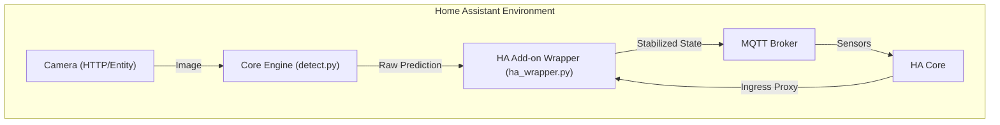
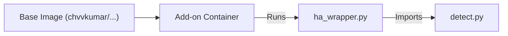
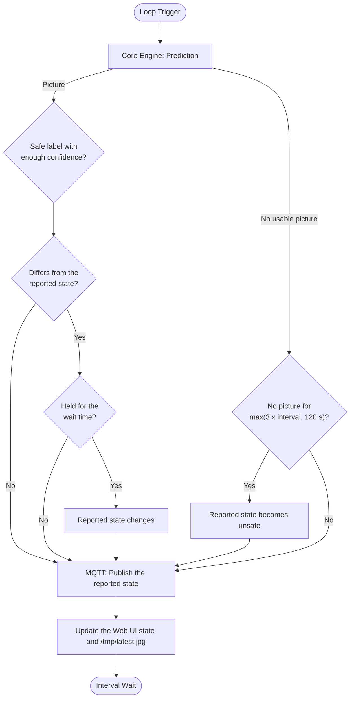

# Architecture: Home Assistant Add-on

This document describes the technical architecture of the **Simple Cloud Detect MQTT** Home Assistant add-on and its relationship with the core project.

## Core Project vs. Add-on Wrapper

The system is split into two distinct layers to maintain compatibility with the original project while providing integration with Home Assistant.

| Feature | Core Project (`detect.py`) | Add-on Wrapper (`ha_wrapper.py`) |
| :--- | :--- | :--- |
| **Model Handling** | Loads Keras `.h5` model and labels | Manages model persistence in `/share` |
| **Logic** | AI Prediction (Clear, Cloud, etc.) | State Stabilization (wait times, per-label thresholds, camera fail-safe) |
| **MQTT** | Basic Discovery & State publishing | `Is Safe` sensor, configurable Last Will (LWT), re-announce after reconnect |
| **Interface** | CLI / Environment Variables | Web UI (Ingress) & HA Options UI |
| **Storage** | Standard File System | Models in `/share`, latest picture in the container's `/tmp` |

## System Integration

The following diagram illustrates how the add-on wrapper orchestrates the core engine within the Home Assistant environment:

## Deployment & Lifecycle

### 1. Container Architecture
The add-on uses a multi-architecture Docker image.

- **Environment**: The `PYTHONPATH` is configured to allow the wrapper to utilize the core engine as a module.
- **Health Monitoring**: A `curl`-based healthcheck calls the internal state API (`:8099/api/state`). The API answers `503` when the detection loop has not finished a cycle within `3 x scan_interval + 60 s`, so a hung loop marks the container unhealthy. Whether the Supervisor restarts an unhealthy container depends on the add-on's Watchdog setting; `config.yaml` does not define a `watchdog:` URL.

### 2. Startup & Model Management

The wrapper manages the initialization sequence to ensure the environment is ready for the core engine:

1.  **Configuration**: Parameters are loaded from `/data/options.json`.
2.  **Web UI**: The internal HTTP server starts first (daemon thread), so the dashboard and the healthcheck answer while the model is still loading.
3.  **Model Synchronization**: Models live in the persistent `/share/simple_cloud_detect/` directory. Missing files are copied from the container's application directory if present there, otherwise downloaded from GitHub (into a `.part` file that is renamed when complete). Afterwards `convert.py` removes the `groups` attribute that Teachable Machine exports contain.
4.  **Authentication**: The `SUPERVISOR_TOKEN` is used to authenticate requests to the Home Assistant API (e.g., for fetching images from camera entities) and to read the MQTT login from the Supervisor's MQTT service when no user and password are configured.
5.  **MQTT and Detector**: The MQTT client is created with its Last Will and connects in the background (a broker that is not reachable yet is retried), then the core `CloudDetector` is initialised with it.
6.  **Detection Loop**: Runs in the main thread; the Web UI thread only reads its state.

## Component Responsibilities

### 1. Add-on Wrapper (`ha_wrapper.py`)
- **Orchestration**: Manages the lifecycle of the detection loop and the Web UI.
- **HA Integration**: Maps Home Assistant options to internal configuration.
- **State Processing**: Implements the stabilization logic (Wait Times) to prevent rapid state changes (`safety_logic.py`).
- **Communication**: Manages the MQTT connection, including the configurable Last Will and Testament (LWT) for the safety sensor and the re-announcement after a reconnect (`mqtt_setup.py`).
- **Tests**: `safety_logic.py` and `mqtt_setup.py` are plain Python and have unit tests in `ha_addon/tests/` that run without TensorFlow, a broker or Home Assistant.
- **Web UI**: Hosts an internal HTTP server (Port 8099) for the dashboard.

### 2. Core Engine (`detect.py`)
- **Inference**: Loads the Keras ML model and performs image classification.
- **Data Acquisition**: Fetches images via HTTP or local file system.
- **Standard Discovery**: Publishes basic MQTT discovery messages for status, confidence and detection time.

## Data Workflow & Stabilization

The detection loop follows a multi-stage process to ensure reported data is stable for safety-critical use cases. The reported state is published every cycle, also while a change is still waiting, so external watchdogs do not expire.

## Technical Infrastructure

### 1. Storage
- **Temporary Files**: The latest picture is written to `/tmp/` inside the container (atomically, via a temporary file), not to `/share` or `/data`. Whether `/tmp/` is RAM-backed depends on how the Supervisor starts the container; it is not guaranteed.
- **Persistent Files**: Only the model files in `/share/simple_cloud_detect/` are kept across restarts.

### 2. Safety Logic (Wait Times)
The wrapper provides independent timers for state transitions:
- **`safe_wait_time`**: The "Safe" condition must be maintained for a defined duration before the state is updated in Home Assistant.
- **`unsafe_wait_time`**: Defines the delay for "Unsafe" transitions (typically set to 0 for immediate notification).
- **Labels**: A reading is safe if its class equals a configured safe label (exact, case-insensitive) and its confidence reaches that label's threshold.
- **Timer**: A reading that differs from the reported state starts the timer of the target state; a reading equal to the reported state cancels it.
- **Camera failures**: Without a usable picture for `max(3 x scan_interval, 120 s)` the reported state becomes unsafe at once, independent of `unsafe_wait_time`. After the pictures return, the safe wait time applies again.
- **Publishing**: Until the first state is released, `false` is published.

### 3. Last Will (LWT) Implementation
MQTT allows one Last Will per connection, so the client registers exactly one, selected by `mqtt_lwt_logic`. If the add-on terminates unexpectedly, the broker publishes it (retained):

- **`unsafe`**: Sets the `Is Safe` sensor to `false` (default). The other sensors keep their last values.
- **`safe`**: Sets the `Is Safe` sensor to `true`. The other sensors keep their last values.
- **`none`**: Sets the availability topic to `offline`, so all sensors of the device show as unavailable.

After every (re)connect, for example after a restart of the broker, the add-on publishes the discovery configs and the availability again.

### 4. Supervisor Integration
- **Ingress**: The internal dashboard is proxied via the Home Assistant sidebar.
- **MQTT service**: `services: mqtt:need` lets the add-on read the broker login from the Supervisor; the options `mqtt_user` and `mqtt_password` take priority.
- **Watchdog**: The healthcheck marks a hung container unhealthy. `config.yaml` does not define a `watchdog:` URL, so automatic recovery depends on the Watchdog setting of the add-on in Home Assistant.
